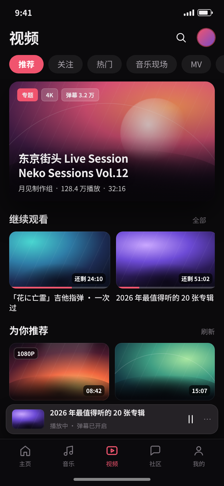
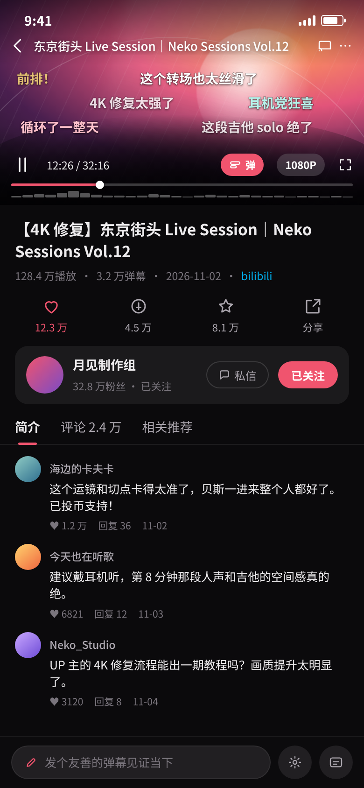
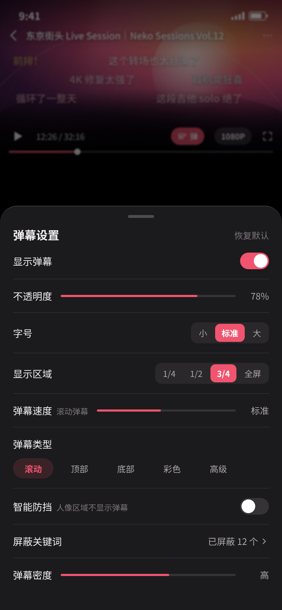
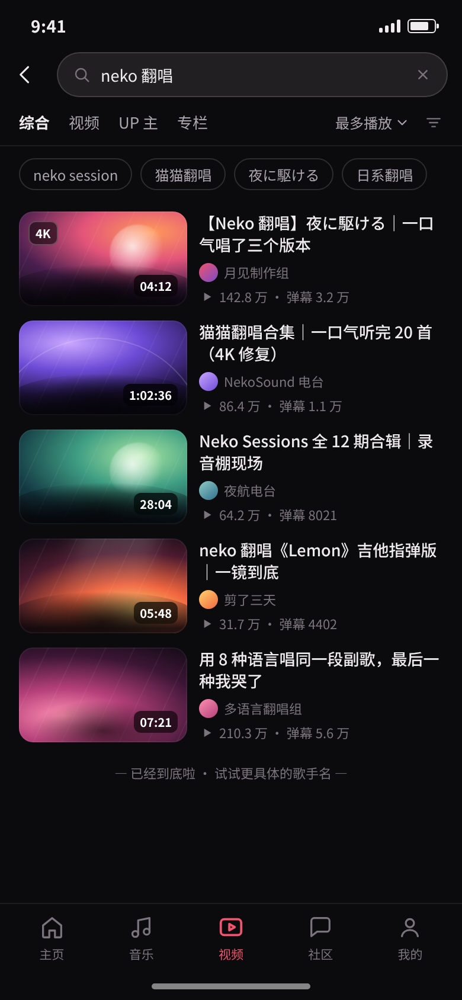
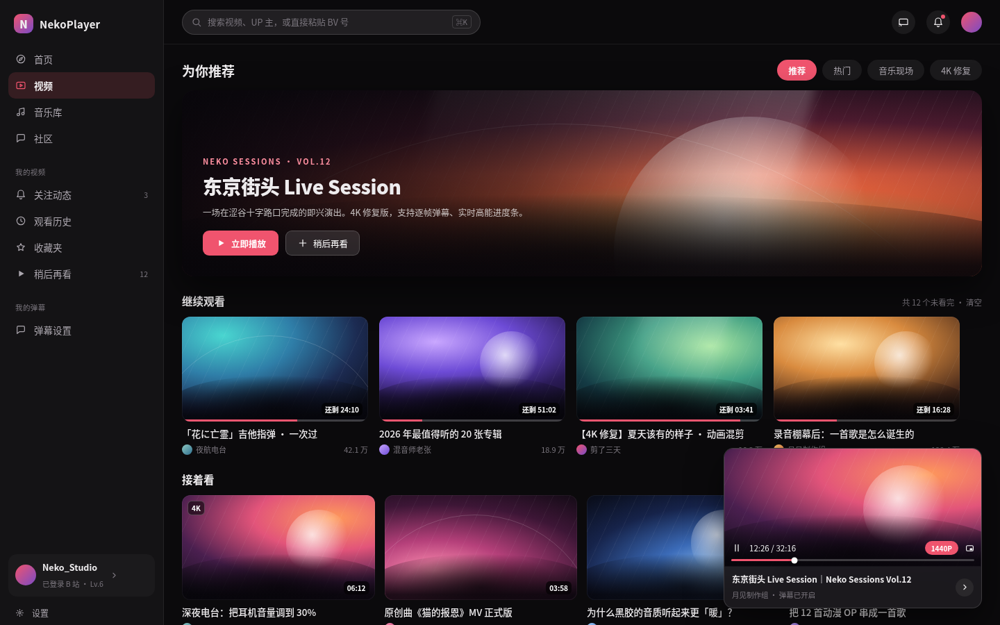
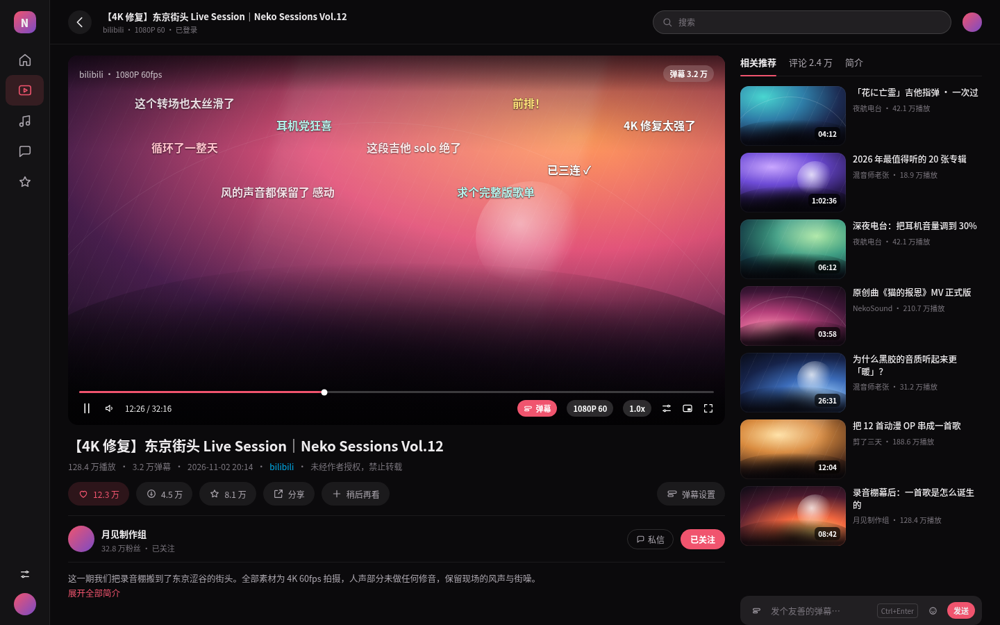

# 视频模块重构 · 设计方案 v0（待确认）

> 目标：把现有「音乐页里的 MV 弹窗」升级为**独立的视频模块**：桌面端独立视频页 + 播放页，Android 端新增「视频」主 Tab + 全屏播放页 + 弹幕 + B 站账号登录。
> 本文只做设计与原型，**未改动任何业务代码**（仓库仅新增 `docs/design/video-refactor/`）。
> 原型：`prototypes/*.html`（可直接用浏览器打开交互查看），截图：`screenshots/*.png`。

---

## 0. 一页结论

| 维度 | 现状 | 重构后 |
| --- | --- | --- |
| 入口 | 音乐页里的一个 MV 按钮 → 弹窗 | 移动端底部第 3 个主 Tab「视频」；桌面前侧栏独立「视频」页 |
| 搜索 | 单输入框 + 平台切换，一屏只有封面网格 | 常驻搜索框 + 分类筛选 + 排序 + 相关搜索 + 信息密度更高的结果卡 |
| 播放 | 弹窗内嵌播放器（桌面黑底 AppBar / 安卓 ModalBottomSheet） | 独立播放页：影院式布局、可收起控制层、弹幕层、手势、投屏/画中画 |
| 弹幕 | 无 | 拉取 + 渲染 + 设置面板（字号/速度/区域/透明度/类型/屏蔽词/防挡）+ 发送 |
| 登录 | 无 B 站账号体系 | 扫码登录（主）+ Cookie 导入（备），Cookie 仅本机加密保存 |
| 视觉 | 与音乐页同风格，但视频场景缺层次 | 暗色影院风，沿用 `#F0546E` 主色与 NekoSpace/NekoRadius 体系 |

---

## 1. 现状与问题（为什么必须重构）

代码层面（已核对）：

- 桌面：`desktop_flutter/lib/ui/music_videos_page.dart`（354 行）＝ AppBar + 搜索框 + Provider ChoiceChip + `SliverGrid`（`maxCrossAxisExtent 320`，`childAspectRatio 16/14`）+ `_VideoPlaybackPage`（media_kit，黑底 + AppBar）。
- 桌面搜索：`desktop_flutter/lib/video_search_controller.dart`（91 行），keyword/page/hasMore 去重合并。
- 数据：`desktop_flutter/lib/data/native_music_catalog.dart:1790` `searchVideos()` → 插件 `music/mv/search`；`:1823` `videoUrl()` → `music/mv/url`（bilibili 走代理 .mp4）。
- 安卓：`app/src/main/java/top/nekoh2o/player/ui/screens/MvSheet.kt`＝`ModalBottomSheet` + `LazyColumn` + `AndroidView(PlayerView)` + ExoPlayer，无全屏页、无手势、无弹幕。
- 全仓**没有弹幕相关代码**；B 站仅出现在聚合音源里。

体验层面（用户原话："之前那个MV搜索太难用了，特别是手机版"）：

1. **手机端只有弹窗**：视频在 `ModalBottomSheet` 里，不能横屏、不能全屏、返回手势容易误关。
2. **搜索维度只有关键词**：没有分类/排序/时长筛选，没有搜索历史与相关搜索，翻页靠一张张网格猜。
3. **信息密度低**：封面卡只显示标题+作者，看不到播放量/弹幕数/清晰度，选片成本高。
4. **播放器是"能播就行"**：没有弹幕、没有倍速/清晰度/画质切换、没有手势、没有记忆播放进度。
5. **没有账号体系**：拿不到 1080P/4K，也没有收藏、关注、历史。

---

## 2. 目标与非目标

**目标（本期）**

- G1 独立视频首页（双端），搜索体验对齐主流视频 App。
- G2 独立播放页 + 弹幕（滚动/顶部/底部/彩色/高级降级）+ 弹幕设置 + 发送。
- G3 B 站扫码登录，登录后解锁 1080P、互动、弹幕发送、收藏/关注。
- G4 桌面端画中画小窗 + 剧场模式；移动端手势 + 横屏全屏。
- G5 视觉与现有 NekoPlayer 主题一致，不引入第二套设计语言。

**非目标（本期不做）**

- 不做直播、番剧/影视分区、UP 主主页、动态流。
- 不做评论区的楼中楼完整交互（先做只读首屏 + 点赞）。
- 不做视频下载/离线缓存（下一期）。
- 不做多账号切换（先单账号）。

---

## 3. 参考与设计原则

参考资料：

- B 站接口与弹幕协议：[SocialSisterYi/bilibili-API-collect](https://github.com/SocialSisterYi/bilibili-API-collect)（`QR.md`、`danmaku_proto.md`、`video/videostream_url.md`）。
- 第三方客户端播放器 UI：[PiliPlus player-ui-components](https://deepwiki.com/bggRGjQaUbCoE/PiliPlus/3.5-player-ui-components)、[animeko video-player-ui-and-controls](https://deepwiki.com/open-ani/animeko/4.1-video-player-ui-and-controls)。两者共同点：**控制层可隐藏 / 弹幕层与视频层分离 / 右侧竖向动作栏 / 相关推荐常驻**。
- 大屏导航与层级：[Lightcast · OTT navigation](https://www.lightcast.com/enhancing-ott-app-navigation-for-improved-user-experience/)（少层级、强焦点、内容优先）。

设计原则（会体现在原型里）：

1. **内容优先**：封面/视频占视觉主体，装饰性元素不超过 2 层。
2. **单手可达**：移动端高频操作集中在底部 1/3；触控目标 ≥ 44dp；主 Tab 5 个不再多。
3. **渐进披露**：播放器控制层默认半透明常驻，点击视频区收起；弹幕设置收进底部弹层。
4. **状态可恢复**：无论搜索还是播放，返回时保留滚动位置、播放进度、弹幕开关。
5. **暗色影院**：沿用 `canvas #0B0A0C` / `surface #141315` / `primary #F0546E` / `tertiary #8FCBC4`，视频区纯黑，避免灰雾。

---

## 4. 信息架构

**移动端（5 Tab）**

```
主页 · 音乐 · [视频] · 社区 · 我的
                 │
                 ├─ 视频首页（推荐/关注/热门/音乐现场/MV/知识）
                 │    └─ 搜索页（综合/视频/UP主/专栏 + 排序 + 筛选）
                 ├─ 播放页（沉浸，隐藏 TabBar）
                 │    ├─ 弹幕设置（底部弹层）
                 │    ├─ 画质/倍速（底部弹层）
                 │    └─ 评论/相关推荐（页内 Tab）
                 └─ 登录页（扫码 / Cookie 导入）
```

**桌面端（左侧栏）**

```
首页 · [视频] · 音乐库 · 社区
        └─ 视频页（推荐 + 继续观看 + 接着看）
             └─ 播放页（剧场布局：左播放器 + 右相关推荐，侧栏收窄为图标栏）
                  └─ 画中画小窗（可拖动，常驻右下）
```

---

## 5. 页面清单与原型

| # | 页面 | 原型 | 截图 |
| --- | --- | --- | --- |
| 01 | 移动端 · 视频首页 | `prototypes/mobile-home.html` | `screenshots/01-mobile-home.png` |
| 02 | 移动端 · 播放页 | `prototypes/mobile-player.html` | `screenshots/02-mobile-player.png` |
| 03 | 移动端 · 弹幕设置 | `prototypes/mobile-danmaku.html` | `screenshots/03-mobile-danmaku.png` |
| 04 | 移动端 · 搜索结果 | `prototypes/mobile-search.html` | `screenshots/04-mobile-search.png` |
| 05 | 移动端 · 扫码登录 | `prototypes/mobile-login.html` | `screenshots/05-mobile-login.png` |
| 06 | 桌面端 · 视频首页 | `prototypes/desktop-home.html` | `screenshots/06-desktop-home.png` |
| 07 | 桌面端 · 播放页 | `prototypes/desktop-player.html` | `screenshots/07-desktop-player.png` |









---

## 6. 关键设计决策（含理由）

1. **移动端用主 Tab，而不是音乐页里的二级入口。**
   理由：视频是独立内容形态，和"听歌"心智不同；Tab 常驻才能被反复使用。代价是 Tab 从 4 个变 5 个——仍在 Material 建议的 3–5 个范围内。

2. **迷你播放器常驻在 TabBar 上方，而不是每次返回都停止播放。**
   理由：解决"看一半退出就丢进度"的核心痛点；点迷你条回到播放页，右滑关闭并保留进度。桌面端对应"画中画浮窗"。

3. **搜索页第一屏就给"类型 + 排序 + 相关搜索"。**
   理由：用户抱怨的本质是"找不到对的视频"，不是"没有搜索框"。分类缩短候选集，排序解决"想看高播放还是最新"，相关搜索解决"关键词不会打"。
   - 输入防抖 300ms，回车立即搜；结果列表分页游标由接口 `hasMore` 决定。
   - 结果卡信息：封面（16:9）+ 时长角标 + 清晰度角标 + 两行标题 + UP 主 + 播放/弹幕数；**比现有网格多 2 个决策信息**。

4. **播放页采用"上视频 + 下内容"的竖屏布局（移动端），横屏转沉浸全屏。**
   理由：符合手机端单手操作（进度条与弹幕开关在视频区底部，评论/相关在下方）；横屏只保留视频+弹幕+控制层，隐藏一切文字区块。

5. **弹幕层独立于播放器渲染层（自绘）。**
   理由：libmpv / ExoPlayer 的 Surface 上叠 Flutter/Compose 文本性能不可控；用独立 layer + 文本测量缓存，才能稳住 60fps 并支持"智能防挡""区域限制""透明度"。

6. **弹幕设置用底部弹层，逐项即时生效（不点确定）。**
   理由：弹幕是"调手感"的偏好，必须所见即所得；`恢复默认` 放在标题右侧。

7. **登录用扫码为主、Cookie 导入为辅；游客可看 720P。**
   理由：扫码无需在 App 内处理密码与风控；Cookie 导入给已经登录过网页版的高级用户兜底。Cookie 只存本机（桌面 `flutter_secure_storage`、安卓 `EncryptedSharedPreferences`/DataStore + Keystore），退出即清除。

8. **桌面播放页侧栏收窄成 72px 图标栏，右栏 348px 常驻相关推荐。**
   理由：把横向空间让给视频（实测 1440 宽下视频可得 946×532），同时保留导航；剧场模式下侧栏可完全收起。

9. **桌面画中画 = 可拖动浮窗（标题栏常显），不是系统级 PiP。**
   理由：跨平台（Windows/Linux）一致，且能与"继续观看"打通；系统级 PiP 留作后续增强。

10. **所有列表页复用 NekoSpace/NekoRadius 与现有色板。**
    理由：不给视频模块引入第二套视觉；原型里所有颜色都取自 `neko_theme.dart`。

---

## 7. 交互细节

**移动端手势（播放页）**

| 手势 | 行为 |
| --- | --- |
| 单击视频 | 显示/隐藏控制层（3s 自动隐藏） |
| 双击左/右半屏 | 后退/前进 10s，中央浮出 `-10s / +10s` |
| 左右拖动 | 水平方向：进度预览（缩略图 + 时间），松手跳转 |
| 左侧上下拖动 | 亮度（仅播放页内，不改系统亮度） |
| 右侧上下拖动 | 音量 |
| 长按 | 3x 倍速，松手恢复 |
| 下滑（视频区） | 缩小为迷你播放器并返回首页 |
| 横屏 | 自动进入沉浸全屏（可关） |

**桌面快捷键**：`Space` 播放/暂停、`←/→` ±5s、`↑/↓` 音量、`F` 全屏、`D` 弹幕开关、`P` 画中画、`Esc` 退出全屏/返回。

**弹幕规则**

- 每 6 分钟一个分段（`segment_index = progress / 360`），进入播放时预取当前段与下一段。
- 同屏上限默认 120 条（设置里"密度"可调 60/120/200），超出丢弃 `weight` 低的。
- 字号 18/25/36 对应"小/标准/大"；颜色取 `color` 字段（RGB888）。
- `mode 7/8/9`（高级/代码/BAS）本期降级为普通滚动或直接丢弃，并在设置里标注"部分高级弹幕不支持"。
- 屏蔽词本地生效（正则 + 关键词），默认内置 B 站常见引战词表（可关）。

---

## 8. 技术方案

### 8.1 分层

```
UI（Flutter / Compose）
  ├─ 页面与导航：video_page / video_detail_page；Tab.VIDEO + VideoScreen
  ├─ 播放器：桌面 media_kit；安卓 Media3 ExoPlayer（均已存在）
  └─ 弹幕：DanmakuController（数据）+ DanmakuPainter（绘制，独立 RepaintBoundary）
网络与协议（共享内置插件，JS runtime）
  ├─ bilibili/video/search | video/detail | video/playurl
  ├─ bilibili/danmaku/seg | danmaku/post | danmaku/config
  └─ bilibili/login/qrcode | login/poll | login/state | logout
存储
  ├─ Cookie：flutter_secure_storage / EncryptedSharedPreferences
  ├─ 偏好：shared_preferences / DataStore（弹幕设置、清晰度偏好、自动横屏）
  └─ 缓存：搜索结果 LRU(50)、弹幕段 LRU(64)、封面走现有图片缓存
```

**放在共享插件里的理由**：仓库已有内置插件运行时（`desktop_flutter/assets/music_plugins/runtime.js`），它内置 `axios`、`cheerio`、`crypto-js`、`qs`、原生 `fetch`，双端共用同一份 JS——B 站搜索/详情/弹幕/wbi 签名只写一次，避免 Dart + Kotlin 两套实现漂移。
**注意（已核对）**：该运行时**不提供原生 Cookie 罐**，报错文案为 `Native cookie access is unsupported; use explicit plugin HTTP headers`。因此登录态由宿主保存，调用插件时以 `Cookie` 头显式注入；插件自身不落盘 Cookie。

### 8.2 B 站接口清单

| 用途 | 接口 | 关键点 |
| --- | --- | --- |
| 搜索 | `GET x/web-interface/wbi/search/type?search_type=video&keyword=&page=` | 需 wbi 签名；返回 `bvid/aid/title/pic/duration/play/video_review/author` |
| 视频详情 | `GET x/web-interface/view?bvid=` | 取 `cid`（弹幕 oid）、分 P、`stat`、`owner` |
| 播放地址 | `GET x/player/wbi/playurl?bvid=&cid=&qn=&fnval=4048&fourk=1` | 需 wbi + 登录才有 1080P+/4K；`Referer: https://www.bilibili.com`、桌面 UA；DASH 取 `video+audio` 分轨 |
| 弹幕分段 | `GET x/v2/dm/web/seg.so?type=1&oid={cid}&pid={aid}&segment_index=n` | protobuf；6 分钟/段；每段最多 6000 条 |
| 弹幕配置 | `GET x/v2/dm/web/config?type=1&oid={cid}` | 字号档位、速度档位、区域默认值 |
| 发弹幕 | `POST x/v2/dm/post` | `csrf=bili_jct`；`type=1&oid=&msg=&mode=&fontsize=&color=&progress` |
| 扫码登录 | `GET x/passport-login/web/qrcode/generate` + `poll?qrcode_key=` | `code`: 0 成功 / 86101 未扫 / 86090 已扫未确认 / 86038 失效；成功响应 `Set-Cookie` 含 `SESSDATA`、`bili_jct`、`DedeUserID` |
| 互动（登录后） | `x/web-interface/archive/like|coin|fav`、`x/relation/modify` | `csrf=bili_jct` |

**wbi 签名**：`img_key + sub_key` 来自 `x/web-interface/nav`，按 `MIXIN_KEY_ENC_TAB` 重排取前 32 位，`params + wts` 排序后 md5。放在插件里实现一次，缓存 `img_key/sub_key` 12 小时。

**弹幕 protobuf 解析**：不引入 protobuf.js（体积大），在插件里手写 wire-format 解码（varint + length-delimited，约 80 行），字段按 `DanmakuElem` 定义读取 `progress/mode/fontsize/color/content/weight/attr`。

**风控要点**（需实测）：`Referer`/`User-Agent` 必须带；`playurl` 未登录只给 480P/720P；连续请求要限速（搜索 ≥ 300ms 间隔、弹幕段并发 ≤ 2）；出现 `-412` 时降级为"直连代理 mp4"（现有 `music/mv/url` 通道可复用）。

### 8.3 数据模型（双端一致）

```text
VideoSummary { id(bvid|aid), cid?, title, cover, upName, upAvatar, durationSec,
               views, danmakuCount, publishedAt, badges[](4K/1080P/热门) }
VideoDetail  { summary, description, pages[], stats{like,coin,fav,share}, owner{mid,name,fans,followed} }
Danmaku      { id, progressMs, mode, fontSize, color, content, weight, pool }
PlaySource   { url, quality(qn), codecs, headers{Cookie,Referer,UA}, expireAt }
```

### 8.4 双端落点（最小改动）

桌面（Flutter）：

- 新增 `lib/ui/video/video_page.dart`（首页）、`video_detail_page.dart`（播放页）、`widgets/video_card.dart`、`widgets/danmaku_overlay.dart`、`video_state.dart`。
- 替换入口：`music_videos_page.dart` 保留为"音乐页内的轻量入口"，点击跳转到新视频页并带上筛选；导航沿用现有 App 壳。
- 复用 `video_search_controller.dart`（扩展 filter/sort/相关搜索）；`native_music_catalog.dart` 的 MV 方法保留，新增 `bilibili_video.dart` 走插件通道。
- 播放器沿用 media_kit；弹幕层用 `CustomPainter` + `Ticker`，`RepaintBoundary` 隔离。

Android（Compose）：

- 新增 `ui/screens/VideoScreen.kt`、`VideoDetailScreen.kt`、`VideoViewModel.kt`、`ui/video/DanmakuOverlay.kt`、`DanmakuSettingsSheet.kt`。
- `ui/nav/MainScaffold.kt`：`enum class Tab` 增加 `VIDEO`，插在 `MUSIC` 与 `SOCIAL` 之间（图标 + 文案"视频"）。
- 播放用 Media3 ExoPlayer（已依赖 `media3 1.4.1`）；弹幕用 `Canvas` + `drawText(textMeasurer)` 并缓存 `TextLayoutResult`。
- 登录复用 `QrLoginDialog.kt` 的交互骨架（已有 zxing core 3.5.3 生成二维码），新增 B 站实现而非新造弹窗。
- Cookie 存 `EncryptedSharedPreferences`（Keystore 派生密钥）。

---

## 9. 里程碑（每阶段可独立验收）

| 阶段 | 内容 | 验收标准 | 相对工作量 |
| --- | --- | --- | --- |
| M1 骨架与搜索 | 视频首页（双端）+ 搜索页（分类/排序/相关搜索/历史）+ 路由与 Tab | 能搜到视频、能点进占位播放页；手机端单手可完成一次完整搜索 | M |
| M2 播放与弹幕 | 播放页（竖屏/横屏）+ 弹幕拉取与渲染 + 设置面板 + 进度记忆 | 1080P 以下可播；弹幕不掉帧（60fps）；设置项即时生效 | L |
| M3 登录与互动 | 扫码登录 + Cookie 导入 + 1080P/4K + 点赞/投币/收藏/关注 + 发弹幕 | 登录后清晰度提升；发弹幕成功后 3s 内出现在屏幕 | L |
| M4 体验打磨 | 桌面 PiP/剧场/快捷键；移动手势/自动横屏；稍后再看/历史/分享 | 全流程无"回到上一步丢失状态"；快捷键全覆盖 | M |

---

## 10. 风险与备选

1. **接口风控（-412 / 需要登录）**：优先走"登录 + wbi"，失败降级代理 mp4（已有通道），并在 UI 上明确提示清晰度降级。
2. **DASH 分轨播放**：桌面 media_kit 支持 `video+audio` 双轨需验证；安卓 Media3 用 `MergingMediaSource`。若成本高，M2 先只播 `mp4` 单文件（720P）。
3. **弹幕性能**：低端机（Android 8）同屏 200 条可能掉帧，用"密度上限 + 字体位图缓存 + 关闭高级弹幕"兜底，并留开关。
4. **插件运行时不支持原生 Cookie**（已确认）：登录态由宿主管理，插件只接受注入的 `Cookie` 头；若后续要做多账号，需要扩展 runtime。
5. **合规**：仅播放用户主动搜索/登录后可见的内容，不内置解析、不绕过付费/大会员内容；Cookie 明示"仅本机保存"。

---

## 11. 待你确认（Q1–Q7）

- **Q1 入口**：移动端加第 5 个 Tab「视频」（原型方案），还是保留 4 Tab、把视频放在「主页」顶部？→ 我推荐前者。
- **Q2 搜索默认源**：视频模块默认只搜 B 站，还是像现在一样聚合多平台（B 站/YouTube 等）？→ 我推荐"默认 B 站 + 可切换聚合"，因为弹幕/登录只对 B 站成立。
- **Q3 登录范围**：只做扫码，还是同时提供 Cookie 导入？→ 我推荐两者都做（扫码主路径，Cookie 给高级用户兜底）。
- **Q4 游客能力**：游客是否允许 720P + 弹幕观看（不发弹幕）？→ 我推荐允许，降低首次使用门槛。
- **Q5 弹幕范围**：本期是否要支持"高级弹幕（mode 7/8/9）"？→ 我推荐本期降级/丢弃，并在设置中标注。
- **Q6 桌面剧场模式**：播放页是否需要"侧栏完全收起 + 视频铺满"的剧场模式？→ 我推荐做（成本低，观感提升明显）。
- **Q7 视觉细节**：原型里的圆角/间距/配色是否 OK？特别是：① 首页大图 Hero 卡是否需要；② 播放页动作栏用"图标+数字"还是"图标+文字"；③ 弹幕设置是否需要"恢复默认"按钮。

> 确认后我按 M1 → M4 开始实现；如有调整，先改原型再改代码。
